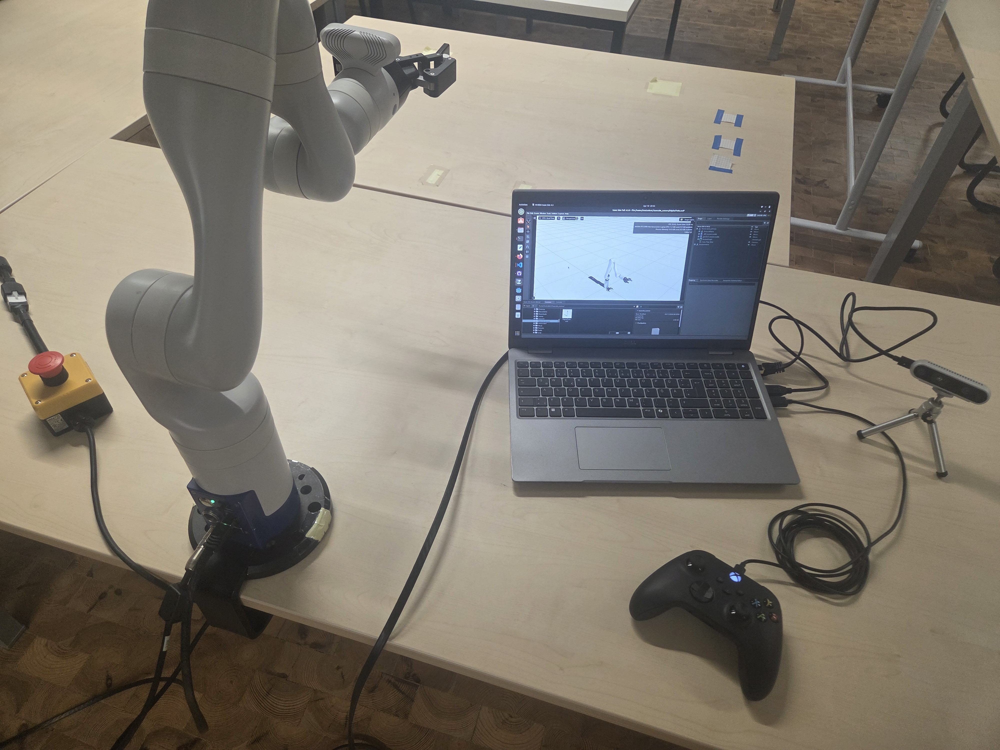
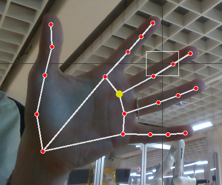
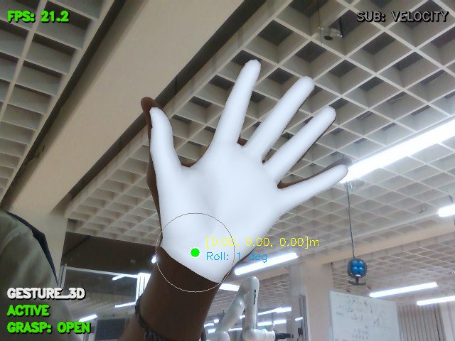
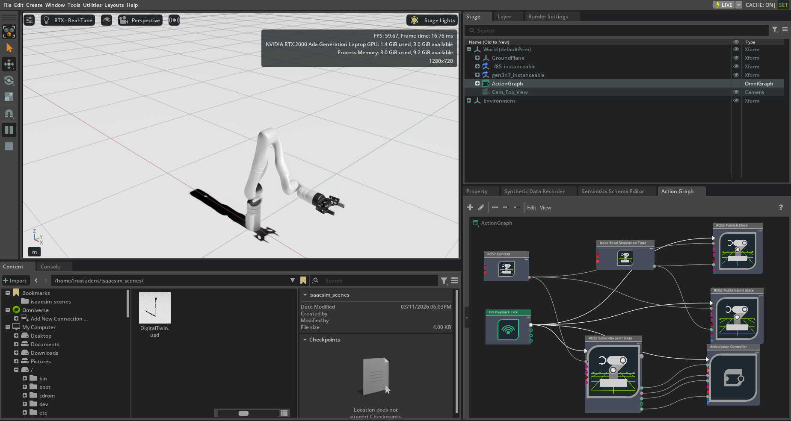
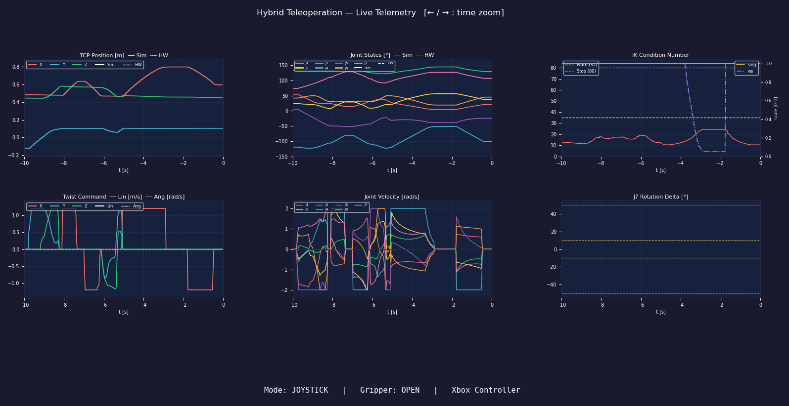

# Hybrid Teleoperation of a Robotic Arm via Digital Twin, Joystick and Gesture Control

**Bachelor's thesis · Frankfurt University of Applied Sciences · Supervisor: Prof. Dr.-Ing. Eric Guiffo Kaigom**

A ROS 2 system for real-time control of a **Kinova Gen3 7-DOF arm** with a **Robotiq 2F-85 gripper**. The operator switches between precise joystick control and contactless control by natural hand movements, with a digital twin in NVIDIA Isaac Sim mirroring the robot.

> ℹ️ This repository is a project showcase. The source code is kept private.

  

---

## Control modes

| Mode | Input | How it works |
|---|---|---|
| **JOYSTICK** | Xbox controller | Precise Cartesian control of the end effector and gripper |
| **GESTURE_2D** | Webcam / RGB stream | MediaPipe tracks 21 hand landmarks; the hand's position and pose are mapped to motion commands |
| **GESTURE_3D** | Intel RealSense D435i | HaMeR reconstructs a 3D hand mesh; the hand's 3D position and wrist roll drive the end effector |

  
  &nbsp;
  

## Highlights

- **Inverse kinematics:** damped-least-squares IK with [Pinocchio](https://github.com/stack-of-tasks/pinocchio) and collision checking via HPP-FCL
- **Singularity handling:** the IK condition number is monitored live, with warning and stop thresholds that scale down motion near singularities
- **Digital twin:** NVIDIA Isaac Sim, connected to ROS 2 through an OmniGraph Action Graph that publishes the simulation clock and joint states and subscribes to joint commands
- **Process isolation:** HaMeR runs in its own Conda environment and streams to the ROS 2 multiplexer via ZeroMQ
- **Live telemetry:** real-time dashboard comparing simulation and hardware signals (TCP position, joint states and velocities, twist commands, IK condition number), with CSV logging
- **Single source of truth:** all tunable parameters in one YAML config

  

  

## Tech stack

`ROS 2 Humble` · `Python` · `Pinocchio` · `HPP-FCL` · `MediaPipe` · `HaMeR` · `Intel RealSense` · `ZeroMQ` · `NVIDIA Isaac Sim 4.5.0` · `Kinova Kortex API`

## What's next

The thesis system is being extended into a **modular ROS 2 plugin platform** for on-orbit satellite servicing research. It integrates teleoperation with a reinforcement-learning-based motion planner and a proximity-triggered smart gripper.

## Publications

- *Toward Task-Grounded, Memory-Augmented Human-Space Robot Interaction for Satellite Servicing*, iSAIRAS (lead author)
- *From Geometric Teleoperation to Vision-Language-Action Models: An Overview of Emerging Frameworks for Intuitive Robot Control* (submitted)
- System paper on hybrid teleoperation of a 7-DOF robotic arm (in preparation)

## Contact

**Nicolas Mahr** · [LinkedIn](https://www.linkedin.com/in/nicolas-mahr-062458281/) · [GitHub](https://github.com/nicolasmahr)